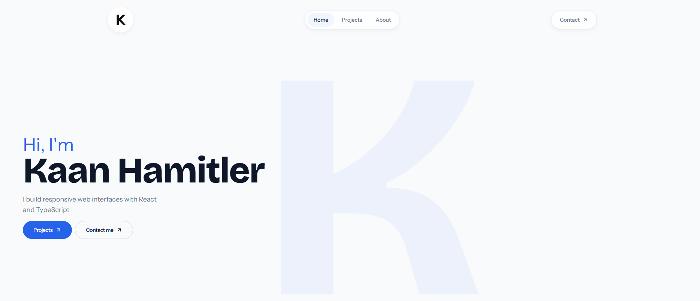

# Kaan Hamitler — Portfolio

A personal portfolio built with React, TypeScript, Vite and Tailwind CSS.
It includes Turkish and English content, project detail pages and a Supabase contact form.



## Technical decisions

- Project cards and detail pages use the active language's project data. Descriptions and links are maintained in the content files.
- The homepage uses section links; React Router provides direct URLs for project details and the privacy notice.
- The contact function saves a validated message before attempting a Resend email notification. A notification failure leaves the saved message intact.
- Supabase database writes and the Resend API key stay in the server function. The browser uses a public publishable key.

## Run locally

Use Node.js 24 and pnpm.

```sh
pnpm install --frozen-lockfile
```

Copy `.env.example` to `.env.local` and set the contact configuration:

| Variable | Purpose |
| --- | --- |
| `VITE_SUPABASE_URL` | Supabase project URL |
| `VITE_SUPABASE_PUBLISHABLE_KEY` | Public publishable key |

The `VITE_ROBOT_*` entries in the template are unused by the current frontend.
Keep server secrets out of `VITE_*` variables, which are included in browser code.
The frontend can be opened without contact configuration; submitting the form requires it.

```sh
pnpm dev
```

Open the URL printed by Vite. Restart the development server after changing environment values.

## Commands

| Command | Purpose |
| --- | --- |
| `pnpm dev` | Start the development server |
| `pnpm test` | Run the Node tests for the menu store |
| `pnpm lint` | Run Oxlint |
| `pnpm exec tsc -b --force` | Check frontend and Vite configuration types |
| `pnpm build` | Run the type check and create `dist/` |
| `pnpm preview` | Serve the existing production build locally |

## Content and routes

- `src/data/enSite.ts` and `src/data/trSite.ts`: interface copy and language-specific content.
- `src/data/projects.ts`: English project entries; Turkish entries are in `trSite.ts`.
- `/projects/:slug`: project description, technical decisions and development notes.
- `/privacy`: contact form privacy notice.

The language choice is stored locally. The page language is updated when switching between Turkish and English.

## Contact backend

The browser calls the `contact` Supabase Edge Function. The function validates the input,
checks submission limits, writes to `contact_messages`, and optionally sends a Resend notification
when the server-side `EMAIL_API_KEY` is configured. The message limit is 1,000 characters.

Schema migrations, disposable database tests and deployment details are documented in
[the backend README](./supabase/README.md). Database tests run separately from `pnpm test`.
The frontend build does not deploy or type-check the Edge Function.

## Deployment

Build the frontend and publish `dist/`. Configure the host to serve `index.html` for client-side
routes such as `/projects/portfolio`. Deploy the Supabase function separately and configure
its server-side secrets if the contact form is enabled.
